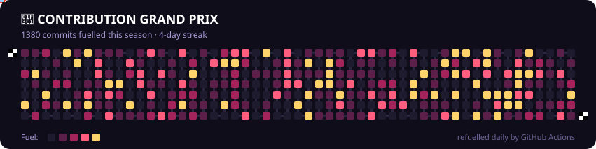

<p align="center">
  
</p>

<p align="center">
  <a href="https://github.com/sean259">
    
  </a>
</p>

<p align="center">
  
  
  
</p>

---

### 🏎️ Driver profile

```yaml
driver:      Seann
class:       Computer Engineering student
fuel:        coffee + side projects
off_track:   gaming 🎮
currently:   building Laurel — a tournament maker website
```

### 🔧 The garage

| Vehicle | What it does | Engine |
|---|---|---|
| 🗄️ [**OffArchive**](https://github.com/sean259/OffArchive) | Curated pre-loved marketplace for clothes, footwear and essentials in Cebu, with admin-reviewed listings and no fees | Astro · Supabase · Cloudflare Workers |
| 🚌 [**my-journey**](https://github.com/sean259/my-journey) | My portfolio as a scroll-driven 3D story: a CRT boots up and you ride a jeepney to CIT-U | Three.js · GSAP · Vite |
| 🚀 [**UConvert-IT**](https://u-convertit-frontend.vercel.app) | All-in-one writing toolkit: paraphrase, humanize, OCR, AI detection, grammar check, quiz maker | Web |
| 🏆 [**Laurel**](https://github.com/sean259/Laurel) *(in the shop)* | A tournament maker website | TypeScript |
| 🛵 **QuestGo** *(in the shop)* | Campus errand & task sharing with ratings and live runner GPS | Next.js · Firebase |
| 👤 [**Personal-Profile**](https://github.com/sean259/Personal-Profile) | My personal profile page | HTML · CSS · JS |

### 🧰 Toolbox

<p align="center">
  
</p>

### 📊 Dashboard

<p align="center">
  
  
</p>
<p align="center">
  
</p>

### 🏁 Contribution Grand Prix

<p align="center">
  
</p>

<p align="center"><sub>Redrawn every night by a GitHub Action from my real contribution graph.</sub></p>
