<p align="center">
  
</p>

<p align="center">
  <a href="https://github.com/YOUR_USERNAME">
    
  </a>
</p>

<p align="center">
  
  
  
</p>

---

### 🏎️ Driver profile

```yaml
driver:      YOUR NAME
class:       Computer Engineering student
team:        CIT-U
fuel:        coffee + side projects
off_track:   gaming 🎮
currently:   building QuestGo — campus errand sharing for CIT-U students
```

### 🔧 The garage

| Vehicle | What it does | Engine |
|---|---|---|
| 🚀 [**UConvert-IT**](https://u-convertit-frontend.vercel.app) | All-in-one writing toolkit: paraphrase, humanize, OCR, AI detection, grammar check, quiz maker | Web |
| 🍽️ [**Hapag**](https://hapag-ph.vercel.app) | Restaurant ordering that keeps guest menu, cashier and kitchen in sync | Web |
| 🏠 [**RentByBob**](https://rentbybob.acegrantk.workers.dev) | Rental management used daily by a landlord, owner and two clerks | Cloudflare Workers |
| 💌 [**Chin Sai Invitation**](https://heyalas.github.io/ChinSaiInvitation) | Digital event invitation | GitHub Pages |
| 🛵 **QuestGo** *(in the shop)* | Campus errand & task sharing with ratings and live runner GPS | Next.js · Firebase |

### 🧰 Toolbox

<p align="center">
  
</p>

### 📊 Dashboard

<p align="center">
  
  
</p>
<p align="center">
  
</p>

### 🏁 Contribution Grand Prix

<p align="center">
  
</p>

<p align="center"><sub>Redrawn every night by a GitHub Action from my real contribution graph.</sub></p>
